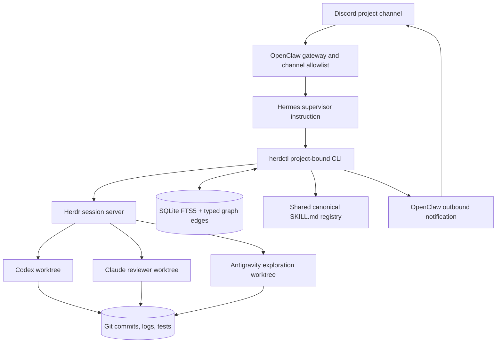

# System architecture

## Ownership
- **Herdr**: workspace, pane, terminal lifecycle and agent detection.
- **OpenClaw**: identity, Discord sessions, inbound/outbound messages, permission policy.
- **Hermes**: plans tasks, requests workers, reviews dependencies and progress.
- **herdctl**: small local CLI adaptor, immutable configured routing, agent/project binding, memory and task checkpoints.
- **Git**: versioned source of truth for code and experiment artifacts.

## Memory model
`memories(id, scope, project, type, subject, content, evidence, status, timestamps)`; `edges(source, relation, target)`; `task_state`; `bindings`. FTS5 indexes subject/content. Queries first SQL-filter scope and status, then select top matches and enforce a character-based approximate token ceiling. No vector model required. Graph traversal limited to 3 hops, and no cross-scope edges.

## Token optimization and later upgrades
Track per-task prompt tokens, memory extraction tokens, completion rate, and hallucinated memory rates before adopting vector or temporal graph. Add hybrid reranking as a separate module only after a measured baseline. Never treat approximate character-to-token estimates as billing metrics.

## Minimal task state machine
`queued -> working -> review -> done`; `working -> blocked`, `review -> working`, failures to `failed`. Transition enforcement not yet implemented; task commands are an operator/supervisor checkpoint interface.
